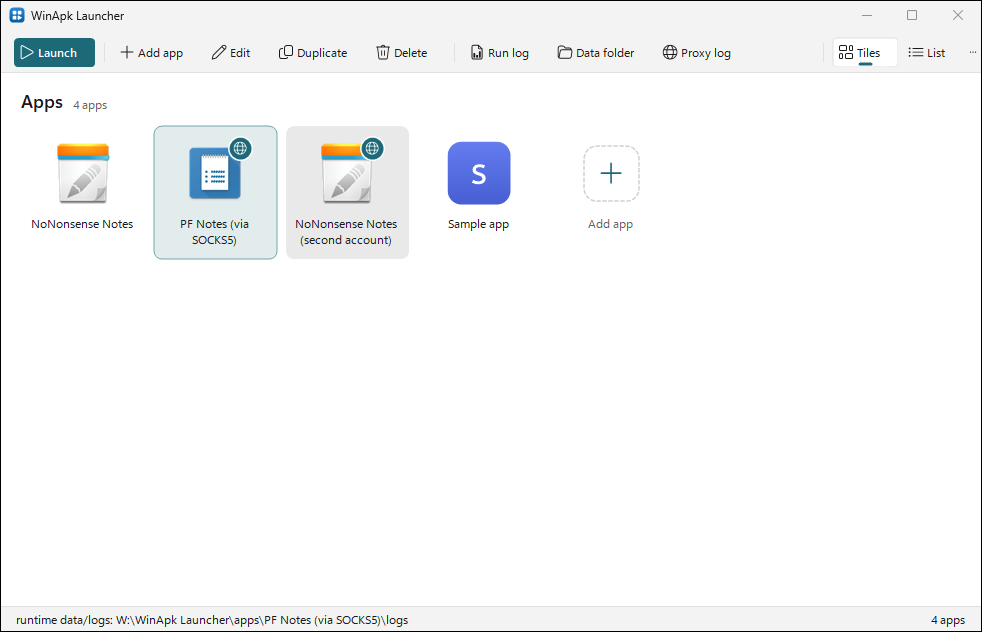
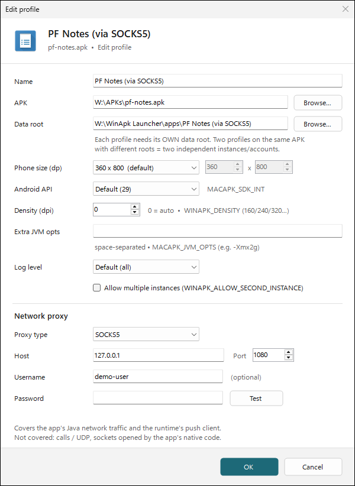
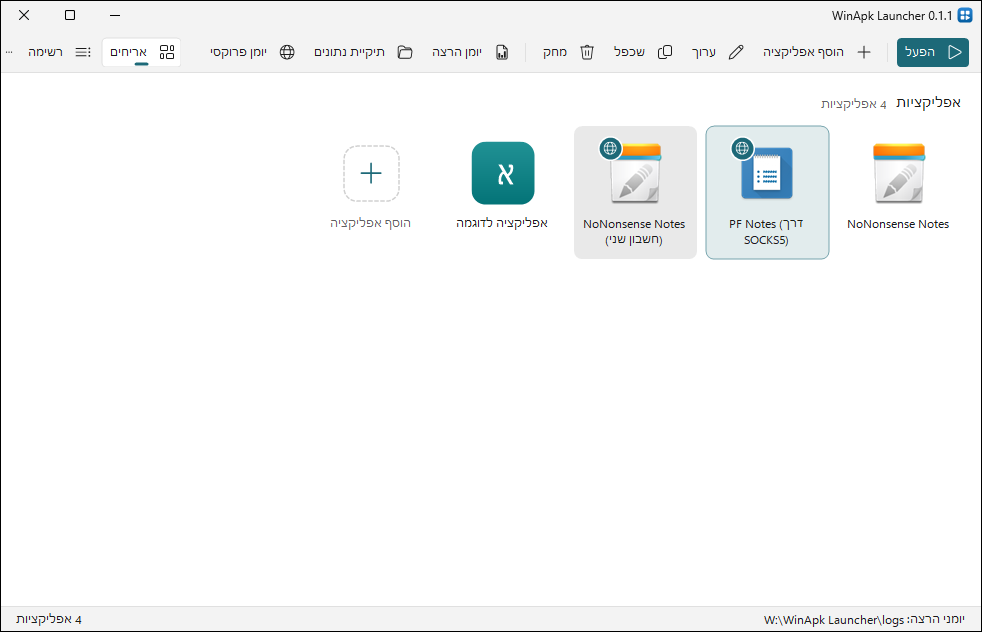
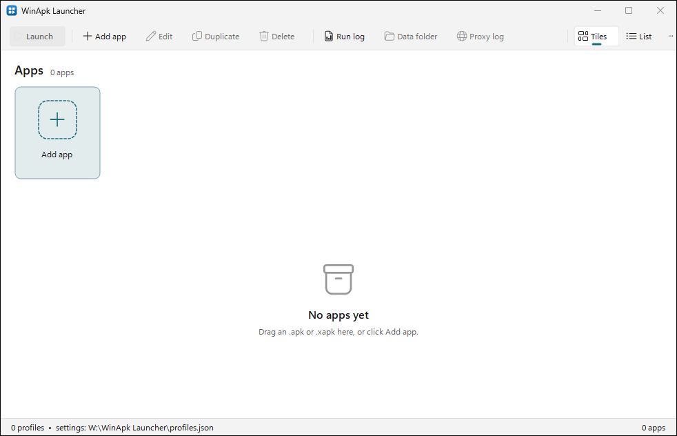
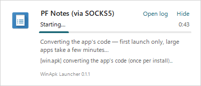
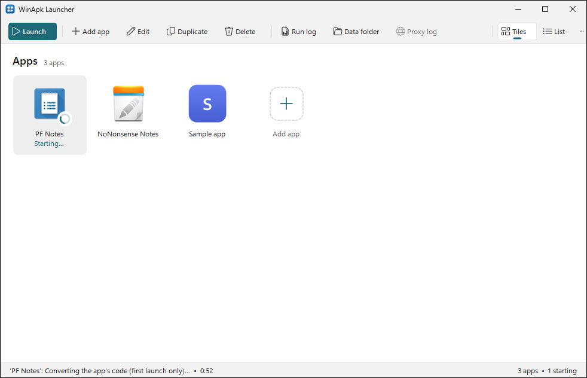

# WinApk Launcher

<div dir="rtl" lang="he">

**עברית:** הממשק של WinApk Launcher זמין גם בעברית, מימין לשמאל. כש-Windows מוצג בעברית הוא נפתח
בעברית, ואפשר לבחור שפה בתפריט **…** ← **שפה / Language**. גם ההתקנה זמינה בעברית. פרטים בסעיף
[Language](#language).

</div>

WinApk Launcher is a Windows launcher and manager for [Win.apk](https://github.com/israel2176/win.apk),
a runtime that runs Android apps (APK files) on Windows 10 and 11 (x64). Each app gets a tile, its
own settings, its own data folder and, if you want, its own network proxy.

A release is one installer that contains both the launcher and the Win.apk runtime, so you don't
need to install anything else.



Which apps run, and how well, depends on Win.apk. See the
[Win.apk README](https://github.com/israel2176/win.apk) for what works.

For what changed in each release, see [CHANGELOG.md](CHANGELOG.md).

## Features

- **Tiles and list views.** App icons come from the packages, including adaptive icons and
  `.xapk`, `.apkm` and `.apks` bundles.
- **Adding apps.** Drag an `.apk`, `.xapk`, `.apkm` or `.apks` file onto the window, select
  **Add app**, or use **Open with WinApk Launcher** in Explorer (an optional installer task).
- **Per-app settings.** Each app is a profile with its own package, data folder ("data root"),
  phone size, Android API level, display density, extra JVM options, log level and a
  multiple-instances switch.
- **Several accounts of one app.** Two profiles can use the same package with different data
  roots. They run as independent apps.
- **Per-app proxy.** Route an app's network traffic through a SOCKS5, SOCKS4/4a or HTTP CONNECT
  proxy, with an optional username and password. **Test** checks the proxy from the Edit dialog.
- **Startup progress.** From the moment you launch an app until its window opens, a small
  startup window shows the current step, and so do the app's tile and the status bar. Launching
  an app that is already running brings its window to the front instead of starting a second
  copy. See [First launch](#first-launch).
- **Logs and shortcuts.** Each launch writes a log. The toolbar opens the **Run log**, the
  **Proxy log** and the app's **Data folder**, and its **…** menu has **Open logs folder**. The
  right-click menu has **Create desktop shortcut**, which launches that app directly.
- **Windows look.** Dark and light themes follow your Windows settings and accent color.
- **English and Hebrew.** The windows are in English or Hebrew, right to left in Hebrew. See
  [Language](#language).
- **Command line.** `--list`, `--launch`, `--dry-run`, `--test-proxy` and more; see
  [Command line](#command-line).



### What the per-app proxy covers

When a profile has a proxy, the launcher starts a small local SOCKS5 adapter for that launch: a
hidden copy of `WinApkLauncher.exe` that listens on `127.0.0.1` and forwards every connection
through the proxy you configured. The launcher then starts the runtime with
`-DsocksProxyHost=127.0.0.1 -DsocksProxyPort=<port>` in `MACAPK_JVM_OPTS` and with
`WINAPK_PROXY=socks5://127.0.0.1:<port>`. The adapter exits when the app exits, and it writes
`proxy.log` in the app's `logs` folder.

The proxy covers:

- the app's Java and Kotlin network traffic over TCP, such as HTTP(S) and WebSocket connections;
- the runtime's built-in push client (Google push), which reads `WINAPK_PROXY`.

The proxy doesn't cover:

- UDP traffic, such as voice and video calls;
- sockets that the app's native (C/C++) code opens;
- other apps and the rest of Windows.

The launcher encrypts the proxy password with Windows DPAPI for your Windows account before it
writes `profiles.json`, so the file never holds the password in plain text. Another Windows user
can't decrypt it.

## Language

The launcher's windows are in English or Hebrew. By default, the launcher follows the Windows
display language: Hebrew when Windows shows Hebrew, and English otherwise.

To choose the language, select **…** > **Language / שפה** in the toolbar, then select
**Automatic**, **English** or **עברית**. The window switches at once, and apps that are running or
starting keep running. The launcher saves your choice in `profiles.json`, as `"Language": "auto"`,
`"en"` or `"he"`.

In Hebrew, the windows read right to left: the toolbar, the tiles, the list and the dialogs are
mirrored. Paths, addresses, ports, JVM options and log lines stay left to right. Command-line
output and the logs stay in English.



The installer also comes in both languages. It asks which one to use, and it preselects the
Windows display language.

To add a language, see the comment at the top of [`src/Strings.cs`](src/Strings.cs).

## Install

1. Download `WinApkLauncher-Setup-<version>.exe` from the
   [Releases page](https://github.com/5566brs/winapk-launcher/releases).
2. Run it. It installs for your Windows user only and doesn't need administrator rights. The
   program goes to `%LOCALAPPDATA%\Programs\WinApk Launcher`.
3. **Optional:** select **Create a desktop shortcut**.
4. **Optional:** select **Add "Open with WinApk Launcher" to .apk and .xapk files**. Explorer
   then offers WinApk Launcher in **Open with** and in the right-click menu. Opening a file with
   it opens the **Add profile** dialog with that file filled in. This task doesn't change the
   default app for `.apk` files.

The installer isn't code-signed, so Windows SmartScreen might warn you. To continue, select
**More info**, then **Run anyway**.

The first time you open the launcher, it has no apps. To add one, drag a package onto the window
or select **Add app**.



To uninstall, open **Apps** in Windows **Settings**, and uninstall **WinApk Launcher**. This
removes the program files and keeps your settings and your apps' data; see
[Where your data lives](#where-your-data-lives).

## First launch

The first time you launch an app, Win.apk installs it and converts its code before it opens the
app's window. This takes a few seconds for a small app and several minutes for a large app, such
as WhatsApp. Later launches skip these steps.

From the moment you launch an app, from the launcher, a desktop shortcut or `--launch`, a small
startup window shows the app's icon and name, a progress bar, the time so far and the current
step: **Installing the app…**, **Converting the app's code — first launch only, large apps take a
few minutes…** or **Starting…**. Under the step, it shows the newest line of the run log. The
window closes when the app's window opens. If the app exits before that, the startup window says
so and offers **Open log** and **Open logs folder**.

- To open the run log while the app starts, select **Open log**.
- To close only the startup window and let the app keep starting, select **Hide**.



If neither the run log nor the CPU time of the app's runtime has changed for 3 minutes, the
startup window says that the app might be stuck, and offers **Open log** and **Stop**. **Stop**
asks first, then ends the runtime, like **Stop it** does. A long code conversion can keep the
log quiet for minutes while it keeps the CPU busy. In that case, the window says **Still working
(CPU busy)…** instead.

In the launcher, the app's tile also shows **Starting…** with a small spinner, and the status bar
shows the step.



If you launch the app again in the meantime, the launcher doesn't start a second copy. It brings
the startup window to the front, and once the app's window is open, it brings that window to the
front.

A profile with **Allow multiple instances** can start another copy, but only after the first copy
has opened its window.

## Portable mode

The release also has a portable zip, `WinApkLauncher-<version>-portable.zip`. To use it, unzip it
anywhere, for example on a USB drive, and start `WinApkLauncher.exe`.

The zip contains a file named `portable.txt` next to `WinApkLauncher.exe`. While that file is
there, the launcher keeps everything in its own folder: `profiles.json`, `cache\`, `logs\` and
the apps' data in `apps\`. If you delete `portable.txt`, the launcher uses the per-user folders
instead. It doesn't move existing files.

## Where your data lives

The launcher stores its files in these places:

| What | Installed | Portable |
|---|---|---|
| Settings and profiles (`profiles.json`) | `%APPDATA%\WinApk Launcher` | the launcher's folder |
| Icon cache | `%LOCALAPPDATA%\WinApk Launcher\cache` | `cache\` |
| Launch logs | `%LOCALAPPDATA%\WinApk Launcher\logs` | `logs\` |
| Apps' data (the default data root of a new profile) | `%LOCALAPPDATA%\WinApk Launcher\apps\<profile name>` | `apps\<profile name>` |
| Win.apk runtime | `runtime\` in the install folder | `runtime\` |

You can change a profile's data root in its Edit dialog. Each data root also holds that app's
runtime logs, in `logs\`, once the runtime has written one.

**Where are the logs?** Each launch writes a run log named
`%LOCALAPPDATA%\WinApk Launcher\logs\<profile name>-<date>-<time>.log`. In portable mode, it's in
the `logs\` folder next to `WinApkLauncher.exe`. Explorer hides the `AppData` folder, so to get
there, select **…** > **Open logs folder** in the toolbar. When an app crashes, its message also
has an **Open logs folder** button, which opens the folder with that log selected.

**How big do the logs get?** Each run log stays under 1 MB: when an app writes more, the log
keeps the first 256 KB of the run and the newest output, with a line that says how much was left
out. Each app keeps its newest 10 run logs, and the logs folder stays under 50 MB; older logs are
deleted when an app is launched, but never the log of an app that is running. To change these
limits, see the folder's size or delete old logs now, select **…** > **Logs…**. An app with a
proxy also writes `proxy.log` in its data root's `logs\` folder, with the same size limit; the
previous one is kept as `proxy.log.1`.

By default, apps don't log the classes they load, which is most of a log. To log them, select
**Detailed class-loading log** in the app's Edit dialog.

Uninstalling keeps the settings and the apps' data. To remove them as well, delete
`%APPDATA%\WinApk Launcher` and `%LOCALAPPDATA%\WinApk Launcher`. Deleting a profile in the
launcher keeps its data root on disk.

Win.apk's own app library (`Win.apk.exe`) keeps its data in `%LOCALAPPDATA%\Win.apk`. The launcher
doesn't use or change that folder.

### How the launcher finds the runtime

When you launch an app, the launcher looks for `winapk-runtime.exe` in this order:

1. The file chosen with **Runtime path…**, if that file exists.
2. `runtime\bin\winapk-runtime.exe` next to `WinApkLauncher.exe`, where the installer and the
   portable zip put it.
3. If neither exists, the launcher asks you to locate the file.

## Command line

`WinApkLauncher.exe` accepts these arguments:

| Arguments | What it does |
|---|---|
| (none) | Opens the launcher. |
| `<package>` or `--add <package>` | Opens the launcher with the **Add profile** dialog filled in for that file. If the launcher is already open, that window shows the dialog. |
| `--list` | Lists the profiles, the settings file and the runtime in use. |
| `--launch <name or id>` | Launches a profile, with its proxy adapter, and returns at once. The app keeps running and writes its output to the run log. A startup window, in a separate process, shows the progress until the app's window opens. Desktop shortcuts use this. If the app is already running, it brings the app's window to the front instead. If the app is still starting, it brings the startup window to the front. In both cases, it starts nothing and exits with code 3. |
| `--launch <name or id> --no-splash` | The same, without the startup window. |
| `--launch <name or id> -s <seconds>` | Launches a profile, watches it for that many seconds, then closes it (a smoke test). |
| `--dry-run <name or id>` | Prints the runtime, arguments and environment variables a launch would use. Starts nothing. |
| `--test-proxy <name or id>` | Runs the Edit dialog's proxy test for a profile. |
| `--status <name or id>` | Prints whether the profile's app is running or still starting, and its runtime processes. Starts nothing. |
| `--self-test` | Runs the launcher's built-in checks. The build workflow runs it on every push. |
| `--icon <package> [out.png]` | Traces the icon extraction for a package. |
| `--theme light` or `--theme dark` | Opens the launcher in that theme. |
| `--lang auto`, `--lang en` or `--lang he` | Opens the launcher in that language for this run. It doesn't change the saved setting. |
| `--screenshot <folder>` | Opens the launcher, saves captures of its views, the Edit dialog, two messages and the startup window to the folder, and exits. It never launches an app. |
| `--version` | Prints the version. |

## Build from source

You need Windows 10 or 11 (x64) and the [.NET 10 SDK](https://dotnet.microsoft.com/download).
To build the installer, you also need [Inno Setup 6](https://jrsoftware.org/isinfo.php).

To build the launcher, run this command in the repository folder:

```powershell
powershell -ExecutionPolicy Bypass -File build.ps1 -Version 0.1.0
```

The script publishes a self-contained `win-x64` folder to `publish\`. The folder isn't a
single-file build, because Windows Forms and the WPF image decoders need their files.

To also build the installer and the portable zip into `dist\`, pass a staged Win.apk runtime
folder:

```powershell
powershell -ExecutionPolicy Bypass -File build.ps1 -Version 0.1.0 -RuntimeDir C:\path\to\Win.apk
```

Replace `C:\path\to\Win.apk` with a folder that has the runtime's `bin\`, `lib\` and `jre\`
folders. Win.apk's `windows/scripts/stage_runtime.sh` creates that folder, without the JRE. The
release workflow, [`.github/workflows/release.yml`](.github/workflows/release.yml), shows the full
build from source.

The build is deterministic and maps source paths to `/_/`, so no local paths end up in the
binaries. To check a build, run `tools\check-paths.ps1` on the files:

```powershell
powershell -ExecutionPolicy Bypass -File tools\check-paths.ps1 publish\WinApkLauncher.exe publish\WinApkLauncher.dll
```

### Make a release

Releases come from the **Release** workflow in GitHub Actions. To run it, open **Actions** >
**Release** > **Run workflow**, and fill in these inputs:

- `tag`: the release tag, for example `v0.1.0`. A tag with a `-`, such as `v0.2.0-beta.1`, makes
  a pre-release.
- `runtime_repo`: the Win.apk repository to build the runtime from, by default
  `5566brs/win.apk`.
- `runtime_ref`: the branch, tag or commit of that repository, by default `bundle/v0.1.0`.

The workflow builds the runtime from source, then the launcher, the installer and the portable
zip, and publishes them as a release of this repository. The release notes give the runtime's
repository, exact commit and a link to its source tree at that commit. The installed files have
the same information in `runtime\SOURCE.txt`.

## Credits

- [Win.apk](https://github.com/israel2176/win.apk) by israel2176 runs the apps.
- [Mac.apk](https://github.com/kksimp/Mac.apk) by kksimp (Kaleb Simpson / Voltare) is the project
  Win.apk is based on.
- The bundled runtime is built from the fork [5566brs/win.apk](https://github.com/5566brs/win.apk),
  which carries extra fixes.
- The runtime includes Eclipse Temurin, ANGLE and other components, and the launcher includes the
  .NET runtime. See [THIRD_PARTY_NOTICES.md](THIRD_PARTY_NOTICES.md).

WinApk Launcher is not affiliated with, endorsed by, or sponsored by Google, WhatsApp or Meta, or
by the Win.apk or Mac.apk projects. Android is a trademark of Google LLC. You are responsible for
having the right to use the apps you run.

## License

WinApk Launcher is licensed under the [GNU Affero General Public License v3.0](LICENSE), like
Win.apk and Mac.apk. Each release's notes link to the exact source of the bundled runtime.
